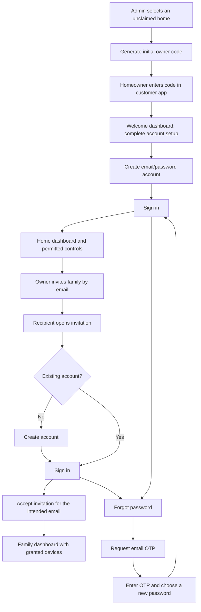

# Customer accounts and household onboarding

Status: requirements reviewed against the repository; awaiting confirmation before implementation.

## Requested outcome

- A platform super admin generates the initial homeowner's one-time code from the home's admin page. The normal customer setup must not require a terminal or expose a code in launcher output.
- The homeowner redeems that code in the customer application and reaches a welcome dashboard with account registration.
- Registration creates the homeowner's email/password account. The customer then signs in with that account to use household controls.
- Homeowners invite family members by email and choose their permitted devices. The acceptance link opens customer registration; an existing account uses sign-in followed by acceptance.
- Both homeowners and family members have sign-in, sign-out, and forgotten-password recovery using an OTP delivered to their registered email address.
- Staff identity remains separate from household identity. Generating an onboarding code does not make the admin a household member or grant staff device control.

## Assumptions to confirm

- Before registration finishes, the welcome dashboard offers account setup and does not enable device controls. Pairing creates limited registration authority rather than a permanent anonymous owner session.
- Initial owner provisioning is allowed only while a home is unclaimed. Once ownership exists, an admin cannot create a second owner or take over the home through the same button.
- The initial code is tied to one home and the intended homeowner's email address. Family invitations are tied to the invited address and never create an owner implicitly.
- Existing household access and settings must survive the upgrade. Existing paired owners need a controlled transition to accounts; no fabricated accounts or default customer passwords.
- Customers use email/password without an authenticator app. Passwords retain the current minimum of 12 characters.
- Registration ends at sign-in, as requested. Later visits go directly to sign-in instead of requesting another initial pairing code.

## User journeys

An emailed link must not consume an invitation merely because a browser or email security scanner opens it. Acceptance and account creation require explicit state-changing requests.

## Current repository findings

| Area | Exists now | Required change |
|---|---|---|
| Admin authentication | Cloud staff email/password accounts and guarded home pages | Add initial homeowner onboarding to the selected home |
| Household access | Hub owner/member clients, device restrictions, immediate revocation | Associate household access with customer accounts and sessions |
| Pairing | Owner codes from installer CLI/local launcher; member codes from owner Access | Add admin-page owner provisioning and limited registration claims |
| Customer interface | Pairing screen and authenticated dashboard | Add registration, sign-in, sign-out, recovery, and emailed invitation acceptance |
| Email | Cloud SMTP adapter and provider failure handling | Add customer invitation/recovery messages and wire the local launcher configuration |
| Cloud/hub transport | Per-hub broker credentials, signed requests, replay checks, trusted-clock checks | Add a separately authorized onboarding operation without bypassing existing support grants |
| Storage | SQLite migrations on the hub; PostgreSQL migrations in the cloud | Add customer identity, membership, invitation, session, and recovery records |

The local launcher currently does not configure SMTP. Neither `SMTP_URL` nor `SMTP_FROM` is present in the inspected process environment. This does not rule out credentials supplied elsewhere, but no working outbound mail service has been established for this flow.

## Non-functional assumptions

- **Scale:** retain the existing local-first architecture intended for 100+ homes. Each home may have multiple family accounts; four is an example, not a hard-coded limit.
- **Performance:** interactive forms, bounded network waits, asynchronous password hashing, and rate limits. Email/provider failures must not hang the application or device command processing.
- **Security:** hash passwords and secret tokens; limit attempts and resends; bind invitations to their home and intended recipient; protect cookie-based writes against CSRF; enforce device permissions on REST and WebSocket paths; never put passwords or recovery codes in logs.
- **Reliability:** retain local household control during cloud/internet outages. Email invitations and password recovery require a working mail service and should report temporary unavailability accurately. Do not pretend a message was delivered.
- **Maintenance:** use the existing TypeScript services, migrations, permission model, and SMTP adapter where appropriate. Document configuration and migration/rollback limits.
- **Privacy:** staff credentials do not authenticate customer APIs. OTPs and invitation secrets must not appear in admin activity tables or application logs.

## Proposed safety defaults for later design review

These are assumptions, not implemented behavior:

- Owner codes: single use, ten-minute expiry; replacing an unused code invalidates it.
- Family invitations: single use, 24-hour expiry, revocable and resendable by an owner.
- Recovery OTPs: six digits, ten-minute expiry, at most five verification attempts, resend cooldown and request limits. A new request invalidates the previous OTP.
- OTP recovery is limited to password reset and cannot be used to create membership, change roles, or switch email addresses.
- Successful password reset ends the account's existing sessions and requires sign-in with the new password. Household sessions must remain separately revocable.
- Invitation URLs use a configured, validated customer application origin. They must not trust a caller-supplied Host header. Localhost URLs are for this workstation only, not family members' phones.
- Admin operations wait for the actual home hub's result, or report that it is unavailable. Do not show a usable code that the hub cannot redeem.

## Decisions already specified by the user

| Decision | Alternative | Reason |
|---|---|---|
| Generate owner codes in the admin page | Require installer terminal commands | Staff should provision homeowners through the product interface |
| Use customer email/password accounts | Require a pairing code for each new browser indefinitely | Familiar customer sign-in and recovery |
| Email invitation acceptance for family members | Share the homeowner's login or manually distribute member codes | Individual access and revocation |
| Email OTP password recovery for both household roles | Depend on staff manually resetting customers | Self-service recovery |

## Work to complete after confirmation

1. Choose and document the customer identity/session placement while retaining local operation.
2. Implement migrations and guarded admin-to-hub onboarding, with a home-claim lifecycle.
3. Implement customer registration, sessions, login/logout, and account-to-home permissions.
4. Implement emailed family invitations, acceptance, expiry, resend, and revocation.
5. Implement password recovery and real SMTP configuration without committing credentials.
6. Update the admin home page and customer screens, retaining the existing device dashboard.
7. Verify normal and expired/replayed flows, cross-home isolation, role/device restrictions, OTP limits, reset revocation, provider failures, and browser journeys.
8. Record live SMTP and physical-device verification separately from automated checks.

No customer-account implementation or live email-delivery verification is claimed by this document.
