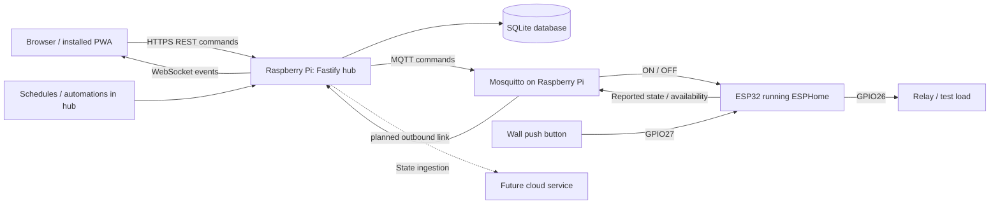

# VOLTEX Home Automation: complete project and engineering guide

Prepared on **28 October 2026**, from the local repository at baseline commit `c2eb59e`.

This guide describes the implementation, its interfaces, deployment, embedded behavior, verification, and remaining engineering work. It separates source-confirmed behavior, historical test records, current checks, and engineering concerns. It covers the project's tracked application, firmware, infrastructure, tests, and supporting files; it does not claim that reading code proves physical behavior or covers every possible defect.

The user-facing brand is **VOLTEX**. The repository, npm packages, MQTT namespace, configuration variables, and deployment commands generally use **voltax**. Both spellings are present in the current project.

## 1. What this project is

VOLTEX is a local-first home automation platform by SoVir Technologies. Each home has a Raspberry Pi hub. ESP32 devices connect to the home's MQTT broker, and people operate the home through a web application served by that same hub.

The implemented product controls boolean switches, displays boolean sensors, runs schedules, evaluates simple event-triggered rules, and manages paired browsers or phones. Internet access is unnecessary for the local control path once the system is installed and the client can reach and trust the hub. Wi-Fi/LAN connectivity, power, and a working hub are still required for app control.

The physical wall button takes a shorter path: ESP32 input directly toggles the ESP32 relay output. This is intended to preserve manual operation during a hub outage. The firmware has not been verified on hardware, and framework reboot behavior requires attention before this becomes an uninterrupted-operation guarantee.

This repository is a **Milestone 1 software prototype with passing PC tests**, not a demonstrated production installation. The acceptance record explicitly marks Raspberry Pi and ESP32 tests as not yet run. Cloud remote control, fleet management, and native mobile wrappers are future work.

Primary evidence: [root README](../README.md), [architecture](architecture.md), [hardware acceptance record](runbooks/milestone-1-results.md), and [firmware](../firmware/esphome/relay-1ch.yaml).

## 2. System architecture and responsibility boundaries



| Layer | Responsibility | Current implementation |
|---|---|---|
| Browser/PWA | Render reported state, pair, submit commands, manage permitted resources | Next.js static export and React client code |
| Hub application | Authorize requests, persist resources, serialize commands, interpret MQTT reports, run rules | Node.js/TypeScript and Fastify |
| Local broker | Authenticate MQTT clients and restrict their topic access | Mosquitto with password file and ACL |
| Device firmware | Operate GPIO, read buttons, report state, maintain MQTT connection | One ESPHome ESP32 configuration |
| Host operating system | Network, time, storage, Docker, service startup, watchdog | Raspberry Pi OS and Bash/systemd configuration |
| Cloud | Remote access, fleet operations, certificate lifecycle | Described in plans; no cloud application in the repository |

One hub contains one home's data. There is no current cloud tenant/account model, shared multi-home database, or implemented multi-hub selector. The architecture aims at 100+ homes by giving each home its own hub; this is a design goal, not a measured fleet result.

### Communication paths

1. **App command:** browser sends authenticated REST request; hub records and queues it; hub publishes MQTT; ESP32 changes its output and reports state; hub stores the report and emits events; browser updates from reported state.
2. **Physical control:** button press executes `switch.toggle` locally in firmware; the output changes without an app request; MQTT reports update the hub and app when connectivity exists.
3. **Schedule:** Croner fires on the Pi; scheduler submits through the same command manager.
4. **Automation:** a live changed entity report matches a rule; the rule submits through the same command manager.
5. **Future remote control:** documents propose cloud-to-hub delivery through the same command manager. No implemented cloud transport should be inferred from this diagram.

## 3. Repository structure and technology

| Directory | Contents |
|---|---|
| `frontend/web/` | Web UI, PWA, routes, providers, CSS, icons, post-build scripts |
| `backend/hub/` | Hub process, API, auth, MQTT adapter, command manager, SQLite, schedules, rules, CLI, tests |
| `shared/contracts/` | Shared Zod request schemas, TypeScript response types, topic helpers |
| `firmware/esphome/` | ESP32 YAML and example secrets |
| `deploy/pi/` | Provisioning, Compose, broker configuration, TLS tooling, systemd, maintenance and acceptance scripts |
| `docs/` | Architecture, decisions, setup/update/recovery runbooks, acceptance record, this guide |
| `.github/` | CI, signed release workflow, pull request template |
| `.claude/` | Development launch configuration |

There are three npm workspaces: `@voltax/contracts`, `@voltax/hub`, and `@voltax/web`. All declare version `0.1.0` and are private packages. The root package is also private.

The declared stack is Node.js **24 or newer**, TypeScript **5.9**, Next.js **16.4.3**, React/React DOM **19.3.1**, Fastify **5.6**, mqtt.js **5.14**, better-sqlite3 **12.4**, Croner **9.1**, Zod **4.1**, and Vitest **5.0.5**. Most package versions are caret ranges; `package-lock.json` records the resolved dependency tree. These are repository declarations, not a statement that they are the latest releases or have passed a vulnerability audit.

The hub uses ECMAScript modules and NodeNext resolution. Shared TypeScript enables strict checking and `noUncheckedIndexedAccess`; the frontend uses bundler resolution and the `@/` source alias. Production frontend output contains static files, so it does not require a second Next.js server on the Pi.

## 4. Data model and terminology

| Term | Meaning | Example |
|---|---|---|
| Hub | One home's local server | `voltax-hub-001` |
| Device | A network-connected ESP32 or simulated device | `esp-relay-01` |
| Entity | One function belonging to a device | `esp-relay-01.switch.relay_1` |
| Switch | An entity the hub can command with a boolean | Relay output |
| Binary sensor | A boolean input, read-only through the command API | BOOT button |
| Client | A paired browser/phone installation with a bearer token | Owner's browser |
| Owner/member | Client authorization roles | Owner manages rules; member controls switches |
| Reported state | Last boolean received from the device | `true`, `false`, or `null` before a report |
| State version | Per-entity counter incremented on changed reports | `stateVersion: 7` |
| Event sequence | Hub-wide persisted event ordering | `seq: 120` |

A device can contain multiple entities. The current hardware YAML exposes one switch and one published binary sensor. The development simulator exposes more entities.

**Rooms are currently device names.** There is no room table or room ID. Renaming the room on an entity detail screen changes its parent device's name, affecting every entity under that device. Different devices with the same displayed room name remain separate groups on Home.

The only supported components are `switch` and `binary_sensor`. The current model does not support dimmer levels, fan speeds, temperature values, energy measurements, RGB values, locks, covers, or analog calibration. A simulated entity named `fan` is simply on/off.

## 5. Frontend: every route and feature

Evidence: [frontend README](../frontend/web/README.md), [route directory](../frontend/web/src/app/), and [feature directory](../frontend/web/src/features/).

| Route | Screen | Implemented behavior |
|---|---|---|
| All routes before pairing | `PairScreen` | Code entry, client name, hub identity, pairing request, error toast |
| `/` | `HomeScreen` | Greeting, switches-on count, devices-online count, clock/MQTT warnings, installation prompt, entity tiles grouped by device |
| `/device/?id=<entityId>` | `DeviceScreen` | Reported state dial, report age, availability, switch action, owner rename, target's schedules |
| `/schedules/` | `SchedulesScreen` | List schedules; owners add daily schedules and delete existing schedules |
| `/automations/` | `AutomationsScreen` | List rules; owners add trigger/action rules with optional return duration and delete rules |
| `/access/` | `AccessScreen` | Owners list paired clients, create member invite codes, revoke another client |
| `/hub/` | `HubScreen` | Health details, software version, MQTT/database/clock status, uptime, role, installer instructions, PWA prompt, browser sign-out |

### App shell and reusable components

- `AppShell.tsx` gates the app on local session restoration, displays pairing when signed out, and provides the logo, connection indicator, route content, and five-tab navigation. Device detail keeps Home selected.
- `Icon.tsx` contains inline SVG paths for bulb, sensor, plus, trash, clock, bolt, chevron, close, home, people, and hub. Icons are hidden from assistive technology when decorative; surrounding controls supply labels.
- `EntitySelect.tsx` lists entities as room/name labels, with an optional switches-only filter. It uses the current hub entity list; it is not a device discovery mechanism.
- `TimePicker12.tsx` presents separate hour, minute, and AM/PM selectors. It deliberately uses a consistent 12-hour display, then converts to 24-hour cron values.
- `InstallCard.tsx` offers the browser installation prompt where available and iOS Add to Home Screen guidance. A compact variant is used on Hub.

### Device presentation and command feedback

`DeviceTile` links to entity detail, shows switch/sensor type and availability, and embeds `PowerSwitch` for switches. Sensor labels are Active/Idle; switch labels are On/Off. The detail screen provides the larger on/off action.

Switch position follows the stored device report. Clicking only creates a pending command; the UI does not immediately pretend the relay changed. A pending control is disabled and pulses. Failures clear the pending state, show a toast, and shake the tile switch. Offline devices have disabled controls, though the browser may still hold old availability when its hub connection is lost.

Owners can edit entity names and the parent device/room label through `RenameForm`. These are two separate PATCH requests, so the save is not one atomic operation. The current browser refreshes afterward; other connected browsers do not receive a dedicated rename event.

### Schedules and automations in the UI

The schedule form captures name, daily time, target switch, and on/off value. It generates `minute hour * * *`; it does not expose arbitrary cron, days of week, edit, or enable/disable controls. Existing rows display enabled/paused badges, and owners can delete them.

The automation form captures name, trigger entity, trigger target state, action switch, on/off value, and optional return seconds. Trigger options include both switches and binary sensors. Target options include switches only. Existing rows display enabled/paused status and can be deleted by owners. There is no UI for editing an existing rule or toggling its enabled flag.

Both APIs support updating and enabled flags; frontend feature coverage is narrower than backend capability. Members can view these resources but cannot change them.

### Access and pairing UX

Users pair a client installation, not a named online account. A member invite is displayed as two groups of five characters with a countdown. Owners see active and revoked clients; the current client is marked You. The UI confirms client removal and protects against removing the last owner through API handling.

Initial owner creation requires the installer CLI. The web invite endpoint always creates a member code. There is no web role promotion, password login, email verification, password reset, or MFA flow.

Signing out clears this browser's stored session; it does not revoke the token server-side. Pairing is required again to use this UI after sign-out.

### Styling and accessibility

`globals.css` supplies a light theme with navy/sky colors, cards, sticky translucent top bar, floating tab bar, responsive grids, status badges, forms, and short animations. The app caps content width at 1080 px; device grids change at 720 px and split panels at 900 px. It respects safe-area insets, reduced motion, reduced transparency, and increased contrast preferences.

Accessibility provisions include labeled switches, `aria-checked`, `aria-current`, labeled time selectors, keyboard Enter on entity tiles, live connection status, focus styling, and alert toasts. Their presence is not equivalent to a completed accessibility or screen-reader audit. There is no implemented dark theme, localization system, search/filter feature, dashboard customization, or independent room management.

## 6. Frontend providers, API client, and live synchronization

Provider nesting is `ToastProvider` -> `PwaProvider` -> `HubProvider` -> `AppShell`.

`HubProvider` owns session, hub identity, health, devices, connection state, pending command IDs, failure counters, REST access, command submission, refresh, and sign-in/sign-out. `useEntities()` flattens device/entity records for screens and selectors.

Session keys are `voltax.token`, `voltax.role`, and `voltax.clientId` in browser localStorage. The API server rechecks the real token role; editing the stored role can affect UI visibility but does not grant server permissions. Bearer token storage makes script injection in this origin particularly sensitive.

`lib/api.ts` prefixes paths with `/api/v1`, JSON-encodes bodies, sends bearer authorization, and throws `ApiError` for failures except HTTP 410, which command callers handle explicitly. Its helper currently supports GET, POST, PATCH, and DELETE; it does not expose PUT, although the backend has PUT update endpoints.

On sign-in or restored session, the provider fetches devices and health, opens WebSocket, and sends authentication as the first message. It handles entity-state events, device-availability events, and terminal command-status events. Unknown entities/devices trigger a fresh snapshot. HTTP 401 and WebSocket close codes 4401/4403 clear the session.

Reconnect delay starts at 500 ms, doubles, and caps at 15 s. Reconnect refreshes devices/health and asks for events after the last sequence the provider processed. Health is not continuously polled while the socket remains open. Rule lists and client lists are fetched by their own screens; rule edits are not pushed as resource-change events.

`ToastProvider` displays the latest message for about 3.2 s. It is not a persisted notification center or a queue of alerts. `format.ts` handles names, daily cron labels, report ages, pairing formatting, and uptime. `uuid.ts` uses `crypto.randomUUID()` with a cryptographically random UUID v4 fallback.

## 7. PWA and static build delivery

`next.config.ts` uses static export, trailing slashes, unoptimized images, and React strict mode. Query-based entity detail allows one static page to handle any runtime entity. The route uses Suspense around search-parameter access.

The post-build script does two jobs: copies Next.js segment prefetch files to the names expected by a plain static host, and generates `out/sw.js` with a content-hashed cache name and a list of exported files. The current verification build mapped 6 prefetch files and precached 67 files.

The service worker precaches the app shell. Navigation is network-first with cached fallback; static assets use cache with background refresh. `/api/` requests are never cached by the worker, and the hub also sets API `Cache-Control: no-store`. Only same-origin GET requests are considered for static caching.

Production registration requires service-worker support and a secure context. PWA updates can activate a new worker and reload the page. The manifest declares standalone display, icons, Home start URL, and Schedules/Automations shortcuts. Browser install dismissal is stored separately as `voltax.installDismissed`.

**Offline shell is different from offline control.** With internet down but the hub reachable, local control can operate. With the hub unreachable, cached UI can open, but new device data and commands cannot work. In-memory last-known reports can remain visible; cache exclusions do not make those reports current.

The private hub CA must be trusted and the hub name resolved for real HTTPS browser use. The PWA cannot install or scope a private CA automatically. The ADR's future native-client trust strategy is not implemented in this repository.

## 8. Hub process and lifecycle

Evidence: [hub source](../backend/hub/src/).

| Module | Responsibility |
|---|---|
| `main.ts` | Load config, read TLS material, create/start hub, listen, handle SIGINT/SIGTERM |
| `hub.ts` | Construct and connect database, event log, store, auth, MQTT, commands, schedules, rules, and API |
| `config.ts` | Validate environment and generate expected TLS name |
| `api.ts` | REST/WebSocket routes, role gates, validation/errors, static app serving |
| `auth.ts` | Pairing codes, hashed tokens, roles, rate limits, client revocation |
| `commands.ts` | Durable command records, duplicate detection, per-entity queue, dispatch, confirmation |
| `mqtt-link.ts` | Broker connection, subscriptions, topic parsing, reports, command publishing |
| `store.ts` | Device/entity persistence and reported state |
| `events.ts` | Sequenced durable event log and in-process subscriptions |
| `scheduler.ts` | Persist cron schedules and run future occurrences |
| `automations.ts` | Match live state transitions, submit actions, manage optional return timers |
| `db.ts` | Open SQLite and apply migrations with backup |
| `cli.ts` | Installer operations on the database |
| `healthcheck.ts` | Probe the local HTTP/HTTPS health endpoint for container health |

Startup opens/migrates the database, builds modules and routes, fails persisted pending/sent commands from the previous run, appends `hub.started`, starts MQTT and schedules, and starts hourly housekeeping. The API then listens on the configured interface/port.

Housekeeping removes terminal commands older than 24 hours, events older than 30 days, and pairing codes expired more than 24 hours ago. These are periodic cleanups, so an individual record may remain until the next hourly pass.

Shutdown stops housekeeping, cron jobs, and automation timers, closes the API and MQTT connection, and closes SQLite. Although the command manager has a `drain()` helper, `hub.stop()` does not call it. Interrupted commands are recovered as failed on the next startup rather than replayed.

## 9. Complete HTTP and WebSocket API

All endpoints below use `/api/v1`.

| Method | Path | Permission | Behavior |
|---|---|---|---|
| GET | `/health` | Public | Status, version, hub ID, DB, MQTT, time-sync indicator, uptime |
| GET | `/hub/identity` | Public | Hub ID, display name, version |
| POST | `/pair` | Public + pairing code | Exchange code/client name for client ID, token, role; 201 |
| POST | `/pairing-codes` | Owner | Create member invite code; 201 |
| GET | `/clients` | Owner | List clients including revoked records |
| DELETE | `/clients/:id` | Owner | Revoke; 204, 404, or last-owner 409 |
| GET | `/devices` | Any paired client | Device list with nested entity reports |
| PATCH | `/devices/:id` | Owner | Change device display name; 204 or 404 |
| DELETE | `/devices/:id` | Owner | Delete database device/entities; 204 or 404 |
| PATCH | `/entities/:id` | Owner | Change entity display name; 204 or 404 |
| POST | `/entities/:id/commands` | Any paired client | Submit absolute boolean command |
| GET | `/commands/:id` | Any paired client | Fetch command or 404 |
| GET | `/events` | Any paired client | Events after a sequence; default limit 500, maximum 1000 |
| GET | `/schedules` | Any paired client | List schedules |
| POST | `/schedules` | Owner | Create schedule; 201 |
| PUT | `/schedules/:id` | Owner | Replace schedule definition; version increments |
| DELETE | `/schedules/:id` | Owner | Delete schedule; 204 or 404 |
| GET | `/automations` | Any paired client | List rules |
| POST | `/automations` | Owner | Create rule; 201 |
| PUT | `/automations/:id` | Owner | Replace rule definition; version increments |
| DELETE | `/automations/:id` | Owner | Delete rule; 204 or 404 |
| GET/Upgrade | `/ws` | Token in first message | Event replay followed by live stream |

Mutation request bodies are validated with shared Zod schemas. API errors use JSON, with unexpected server failures logged and returned as `internal error`. Fastify uses `trustProxy: false`; pairing limits use the actual peer address.

Status meanings: 400 invalid input/cron, 401 missing or invalid authentication/pairing, 403 owner-only restriction, 404 missing resource, 409 command-ID conflict or last-owner protection, 410 expired command, 422 non-controllable entity, 429 pairing rate limit, and 500 unexpected server error.

### Request contracts

| Request | Fields and bounds |
|---|---|
| Pair | `pairingCode`: 6-32 characters; `clientName`: trimmed, 1-64 |
| Rename | `name`: trimmed, 1-64 |
| Command | UUID `commandId`; boolean `value`; optional integer `ttlMs` 1000-30000; optional positive integer epoch-ms `expiresAt` |
| Schedule | Trimmed name 1-64; cron string 1-64; entity ID; boolean value; enabled defaults true |
| Automation | Trimmed name 1-64; enabled defaults true; trigger `{entityId,to}`; action `{entityId,value,revertAfterSeconds?}` |
| Return duration | Integer 1-86400 seconds |
| WebSocket first message | `{type:"auth", token, resumeAfterSeq?}` with nonnegative integer sequence |

Entity ID schemas permit `device.switch.object` or `device.binary_sensor.object` with letters/digits/underscore/dash in device/object segments. Installer shell IDs are stricter: lowercase, digits/dashes, 3-40 characters, alphanumeric ends. Hub config and topic parsing do not use exactly the same ID validation.

### WebSocket wire behavior

The first authentication message must arrive within 5 s. Invalid authentication closes with 4401; revocation through the running API closes that client's sockets with 4403. The server sends `{type:"event",event}`, `{type:"ready",lastSeq}`, or `{type:"error",error}`.

Events have numeric sequence, UUID, type, JSON payload, and epoch-ms creation time. Supported types are `entity.state`, `device.online`, `command.status`, `schedule.fired`, `automation.fired`, and `hub.started`. There are no rename/delete/rule-definition/client-list update event types.

The server replays from the requested sequence and subscribes in the same synchronous tick. However, the replay call returns at most 1000 records and does not loop through additional pages. A client missing more than that needs stronger reconciliation than the current implementation provides.

## 10. Command engine: guarantees and their boundaries

The shared command manager is a central architectural strength: app requests, schedules, and rules use the same dispatch logic.

1. Look up the command UUID. A duplicate with the same entity/value returns the existing result; a different entity/value returns 409.
2. Confirm the entity exists and is a switch; otherwise 404/422.
3. Compute the deadline as the earlier of an explicit `expiresAt` and now plus TTL. Default TTL is 10 s; API TTL accepts 1-30 s.
4. Persist pending or already-expired status and append a command event. Already-expired commands return 410 without enqueueing.
5. Queue commands by entity. One command per entity runs at a time; different entities can proceed independently.
6. Before dispatch, check deadline, MQTT connection, and device availability. Offline/broker-down commands fail rather than waiting for reconnection.
7. Publish absolute `ON`/`OFF` at QoS 1 with `retain:false`; mark sent.
8. A matching non-retained device report resolves confirmation. MQTT publish acknowledgment alone is insufficient.
9. At the deadline, the code has a fallback: if stored entity state already equals the target and the device is marked online, it confirms with reason `device already reported the requested state`. Otherwise it fails for missing confirmation.

The lifecycle is pending -> sent -> confirmed/failed; expiry before dispatch/while queued becomes expired. After a hub restart, persisted pending/sent commands become failed with `hub restarted`.

Several claims need precise wording:

- The timeout fallback means **not every confirmed command has a fresh post-send state report**, despite the simpler wording in the architecture document.
- Matching uses entity and boolean, not a command ID echoed by firmware. A physical button or another actor producing that value can satisfy the waiter.
- GPIO reports express firmware output state. There is no current/contact feedback proving the physical load actually energized or the relay contacts moved.
- Idempotency lasts while the command record exists; terminal records are pruned after approximately 24 hours. It is not permanent exactly-once execution.
- MQTT payloads contain only `ON`/`OFF`, without UUID or deadline. The ESP32 cannot independently reject a command by age or deduplicate it by UUID. Transport loss during publish and broker/session queues therefore need fault-injection testing before claiming end-to-end late-command prevention.
- The in-memory per-entity queue has no explicit application-level size limit. TTL bounds useful age but does not itself impose a request-rate or memory limit.

## 11. MQTT contract, availability, and discovery

Evidence: [topic helpers](../shared/contracts/src/topics.ts), [MQTT adapter](../backend/hub/src/mqtt-link.ts), [broker ACL](../deploy/pi/mosquitto/acl.template).

| Topic | Direction | Payload | Retention |
|---|---|---|---|
| `voltax/<hub>/<device>/status` | Device -> hub | `online` / `offline` | Birth/will retained |
| `voltax/<hub>/<device>/switch/<object>/state` | Device -> hub | `ON` / `OFF` | Device state retained |
| `voltax/<hub>/<device>/binary_sensor/<object>/state` | Device -> hub | `ON` / `OFF` | Device state retained |
| `voltax/<hub>/<device>/switch/<object>/command` | Hub -> device | `ON` / `OFF` | Hub never retains |

The hub subscribes to status, state, and command wildcard layouts for its own hub ID. It ignores topics outside that namespace or unsupported components and ignores state payloads other than ON/OFF after trimming/case normalization. Status currently treats a trimmed `online` payload as online and every other value as offline.

Receiving a status/state creates device/entity records as needed. This is passive discovery of a credentialed device reporting its contract, not Home Assistant discovery, BLE onboarding, or a user wizard. A state report updates last-seen time but does not independently set device online; status messages control availability.

Changed reports increment `stateVersion` and emit state events. Duplicate values update database timestamps but do not emit a state-change event. Retained reports restore snapshots but are excluded from automation triggers and ordinary command confirmation.

The hub uses a clean MQTT session and reconnects every 2 s. It clears nonempty retained command messages encountered on subscription. That protects against one replay source; clearing after reconnect is not equivalent to a broker policy forbidding retained commands or an application-level device deadline.

Mosquitto listens on plaintext TCP 1883 on all interfaces, with host firewall restricting inbound access to LAN. Anonymous login is disabled. Broker persistence is enabled; autosave is 60 s, persistent-client expiry is 1 hour, queued messages cap at 100, and QoS 0 offline queueing is disabled.

Each device has its own username/password. ACL patterns allow writing its own status/state topics and reading its own commands. The hub account can read/write its home's entire namespace. The health account can read broker uptime; general device-pattern rules also apply to usernames, so it should not be described as absolutely read-only across all possible topics without tighter ACL review.

There is no current per-device client certificate, MQTT TLS listener, message signature, device identity attestation, RSSI telemetry, firmware-version telemetry, heartbeat dashboard, or availability freshness timeout. The SQLite online flag is persisted and not reset on startup or broker disconnect; it can temporarily describe an old observation.

## 12. SQLite persistence and event history

Evidence: [initial schema](../backend/hub/migrations/001_init.sql), [database module](../backend/hub/src/db.ts), [store](../backend/hub/src/store.ts).

| Table | Persisted fields / purpose |
|---|---|
| `hub_meta` | Key/value metadata; pairing failure count |
| `devices` | Device ID, display name, online flag, last seen |
| `entities` | Entity ID, parent device FK, component, display name, state, version, update time |
| `commands` | UUID, target, value, source, status, reason, issued/deadline/sent/done times |
| `events` | Autoincrement sequence, UUID, type, JSON payload, time, future cloud-sync timestamp |
| `clients` | UUID, name, role, token hash, creation/revocation times |
| `pairing_codes` | Code hash, role, expiry, usage time |
| `schedules` | UUID, name, cron, target, value, enabled, version, update time |
| `automations` | UUID, name, enabled, JSON trigger/action definition, version, update time |

All timestamps are epoch milliseconds. Booleans are stored as SQLite integer 0/1; entity state is nullable. Commands/events have time indexes. No cloud code currently uses `cloud_synced_at`; the presence of the column is preparation only.

The connection uses WAL journaling, `synchronous=FULL`, foreign keys, and a 5 s busy timeout. These improve durability and concurrency within the local process; actual power-cut survival still depends on filesystem/storage/power behavior and must be tested.

Migrations are sorted `NNN_name.sql` files tracked through `PRAGMA user_version`. They run forward in transactions. Before changing an existing schema, the code creates a consistent `VACUUM INTO` backup when a backup directory is available. Only `001_init.sql` currently exists.

The event log assigns sequence numbers independently of wall-clock order and synchronously notifies in-process subscribers after inserting. Its records are retained for roughly 30 days. It is not a permanent audit archive, and no event-history UI or cloud synchronization exists.

Deleting a device through `Store` removes its entities/device record. It does not delete related schedules, automation definitions, command history, MQTT credentials, or retained broker messages. The shell removal workflow performs additional broker cleanup. Rule references are not database foreign keys to entities.

## 13. Schedules and automation engine details

Schedules run on the hub using Croner and the configured `TZ`, default `Asia/Kolkata`. Enabled jobs are armed at startup and after create/update. Existing jobs are stopped before replacement; deletes stop jobs. Cron expressions are validated with Croner, and execution uses `protect:true`.

Missed runs during hub downtime are not replayed. Each firing appends `schedule.fired` and submits a new command UUID. A fired event means the engine attempted to submit; it is not proof that a relay changed. Engine code does not inspect all submit-error results before recording the firing.

Rules match only live, changed reports with the configured entity and boolean. Retained snapshots and duplicate same-value reports do not trigger. Matching iterates the stored automation list; there is no indexing, condition tree, priority system, cooldown, or cycle detector.

An action submits one command. Optional `revertAfterSeconds` later submits the opposite boolean, rather than restoring a captured previous state. Retriggering the same timed rule restarts its timer. Different rules targeting the same entity can still interact.

Return timers exist only in memory and are dropped on hub stop/restart. Deleting a rule cancels its timer. Updating/disabling a rule does not currently cancel an already-running return timer, and timer creation is not conditional on successful initial command execution. Manual changes can also be overwritten by the later opposite command.

Schedule/rule creation validates ID syntax but does not verify every reference exists or that action targets are switches. The UI normally constrains choices; direct API callers can store invalid relationships that fail later. Version fields increment but are not optimistic-concurrency preconditions, so concurrent edits can overwrite one another.

There is no sunrise/sunset, holiday calendar, time interval editor, multi-condition rule, scene, multi-action transaction, device-side countdown, or persisted delayed-job system in this snapshot.

## 14. Authentication, authorization, and secrets

Pairing codes use ten Crockford-base32 characters: 50 random bits, displayed as `XXXXX-XXXXX`. Normalization accepts lowercase and separators. Owner codes last 10 min by default; member codes last 5 min. Codes are redeemed once in a transaction. New client tokens contain 32 random bytes (256 bits), encoded base64url; only SHA-256 hashes of codes/tokens are stored in SQLite.

After five failed attempts from an IP in a rolling 15 min window, that IP is rate-limited. Ten failed guesses across IPs invalidate open pairing codes until a deliberate new code is created. The global counter persists in hub metadata; IP attempt history is process memory. Opening a new code resets the global counter, not the in-memory IP window.

Roles are enforced by API prehandlers. Members can control every current switch and read devices, commands, events, schedules, and rules. Owners additionally rename/delete database devices, manage schedules/rules, invite members, and revoke clients. There are no per-room/per-device grants, expiring member tokens, session rotation, or automatic bearer-token expiry.

Revocation through the running REST API invalidates later requests and notifies that process's active WebSockets. The installer CLI is a separate process: it persists revocation but cannot emit into the running process's in-memory listener set. Consequently immediate socket closure is not guaranteed for CLI revocation until reconnection or another authentication check.

HTTP API responses avoid caching; main logging redacts Authorization and avoids intentional pairing secret logs. No project-specific CSP/security-header middleware or general authenticated-request rate limiter is configured. Public health/identity intentionally disclose hub metadata to network peers.

`.gitignore` excludes `.secrets/`, common environment files, `secrets.yaml`, PEM/key files, build output, and development DB data. **It does not currently exclude `secrets.<deviceId>.yaml`, despite that name being printed by `add-device.sh`.** A current `git check-ignore` confirmed that discrepancy using path names only. Keep actual credentials in an ignored location; this assessment did not read them.

Repository security policy requests private vulnerability reporting to the SoVir IT team, but gives no concrete email address. Release-signing keys and registry secrets are intended for protected/offline storage, not the repository.

## 15. ESP32 firmware and embedded behavior

The only firmware implementation is [relay-1ch.yaml](../firmware/esphome/relay-1ch.yaml). It selects `esp32dev` and the ESP-IDF framework, with INFO logging, configured Wi-Fi, password-protected ESPHome OTA, and MQTT. No native ESPHome API or fallback access point is configured. Firmware behavior is declared through ESPHome YAML; the repository has no separately maintained application C/C++ source, custom RTOS task implementation, or bootloader project.

| Hardware function | Configuration |
|---|---|
| Relay | GPIO26 output, `relay_1`, plain GPIO pin declaration without inversion |
| Wall button | GPIO27 to ground, input pull-up, inverted input, 30 ms delayed-on/off debounce |
| Local button action | `on_press` toggles `relay_1` directly |
| Wall button publication | `internal:true`; not a hub entity |
| BOOT test input | GPIO0, pull-up, inverted, same debounce; published as `boot_button` |
| Relay restore policy | `RESTORE_DEFAULT_OFF`: use saved state where available, otherwise off |
| Topic prefix | `voltax/${hub_id}/${device_id}` |
| Device identity | Device ID also used as MQTT username/client ID |

The BOOT button is for testing a hub automation, such as press -> relay on -> opposite state after 60 s. That automation does not exist automatically just because the button is in YAML; an owner must create it.

The wall input is configured for a momentary push button. A latching rocker requires a different event policy; the YAML comment suggests `on_state` instead of `on_press`, which still needs validation against the desired physical switch behavior.

The firmware's wiring comment describes a 5 V relay module and GPIO26 input connection. It is an example, not a complete electrical design or assurance that an arbitrary relay board is compatible. The repository contains no PCB/schematic, specified relay part, driver design, load ratings, enclosure design, fuse/thermal design, or manufacturing test procedure.

First flash is described over USB, with later updates through ESPHome OTA. `secrets.yaml.example` contains placeholder Wi-Fi, broker, MQTT password, and OTA password. The YAML uses substitutions for hub/device IDs and the device ID as username; copying every key printed by `add-device` into a secret file does not automatically change those substitutions. The documented flow requires aligning both.

### Embedded findings checked against current ESPHome documentation

- Wi-Fi and MQTT each document a default **15 min disconnection reboot timeout**. Neither is overridden here. Inference: a long outage may repeatedly reboot the node and interrupt local button control. See [Wi-Fi](https://esphome.io/components/wifi/#configuration-variables) and [MQTT](https://esphome.io/components/mqtt/#configuration-variables).
- ESPHome preferences normally flush to flash at **1 min** intervals. Inference: an abrupt power cut soon after switching may restore an older saved state, so “restores last state” needs a tested timing boundary. See [preferences](https://esphome.io/components/preferences/).
- Relay input polarity and reset behavior require the selected hardware. ESPHome documents active-low configuration and warns that reset-time GPIO conditions can activate relays before application control. See [GPIO switch](https://esphome.io/components/switch/gpio/).
- MQTT session cleanliness is not explicitly configured in this YAML; ESPHome documents `clean_session:false` by default. Its actual queue/subscription behavior should be included in stale-command acceptance testing. See [MQTT](https://esphome.io/components/mqtt/).

These are source/documentation findings, not measured failures on this device. ESPHome and toolchain versions are not pinned in the repository, and firmware compilation is absent from CI. There is no flash-encryption, secure-boot provisioning, signed fleet OTA pipeline, rollback partition validation, or firmware recovery-button workflow implemented here.

Before use beyond the low-voltage prototype, validate the exact board and relay polarity, boot-time output, supply brownouts, switch bounce, GPIO0 boot interactions, output restoration timing, Wi-Fi/broker recovery, sustained temperature, and load feedback expectations. The project's own firmware instructions restrict testing to low-voltage loads until mains work is signed off by an electrician. This repository does not provide evidence of electrical certification.

## 16. Hub configuration reference

Configuration is parsed by Zod. Invalid required values abort startup with issue descriptions.

| Variable | Default / requirement | Purpose |
|---|---|---|
| `HUB_ID` | Required; lowercase letters/digits/dashes, 3-40 | Namespace and hub identity |
| `HUB_NAME` | `Voltax Hub` | Public display name |
| `HOST` | `0.0.0.0` | HTTP server interface |
| `PORT` | `8443`, integer 1-65535 | API/static server port |
| `DB_PATH` | `/var/lib/voltax/hub/hub.db` | SQLite file |
| `BACKUP_DIR` | `/var/lib/voltax/backups` | Migration backup location |
| `MQTT_URL` | `mqtt://127.0.0.1:1883` | Broker connection |
| `MQTT_USERNAME` | `hub` | Hub broker account |
| `MQTT_PASSWORD` | Required nonempty | Hub broker credential |
| `TLS_CERT` | `/etc/voltax/tls/hub.crt` | Hub certificate |
| `TLS_KEY` | `/etc/voltax/tls/hub.key` | Hub private key |
| `TLS_CA` | `/etc/voltax/tls/ca.crt` | Local health-check trust |
| `ALLOW_INSECURE_HTTP` | `false` | Development-only HTTP override |
| `UI_DIR` | `/app/public` | Static frontend directory |
| `TIME_SYNC_FILE` | `/run/systemd/timesync/synchronized` | Time-sync indicator checked by existence |
| `TZ` | `Asia/Kolkata` | Scheduler timezone |
| `VOLTAX_VERSION` | `dev` | Reported software version |
| `LOG_LEVEL` | `info`; standard fatal/error/warn/info/debug/trace choices | Application logging |

The development frontend uses `HUB_URL`, default `http://localhost:8080`, for REST rewriting and its WebSocket origin. The API client also reads build-time `NEXT_PUBLIC_HUB_WS_ORIGIN`. The simulator accepts `PORT` and `MQTT_PORT`; these are separate from the production host's broker setup. Update tooling additionally supports `VOLTAX_REPO` and `HEALTH_TIMEOUT`.

Changing the hub `PORT` alone does not update provisioning firewall, mDNS, health shell helpers, or certificates/name resolution. Production deployment assumes 8443 across those files. The time-sync boolean only checks a file's existence; unsynchronized time warns the UI but does not automatically pause schedules.

## 17. Raspberry Pi deployment and host operations

The documented target is Raspberry Pi 4, Raspberry Pi OS Lite 64-bit (`aarch64`), preferably Ethernet. The setup runbook calls for an endurance card, appropriate official supply, SSH public key, hostname, and Asia/Kolkata timezone. Hardware checks include throttling status and architecture. None are current hardware results.

`provision.sh` runs as root through a non-root administrator's sudo session. It validates identity/name/architecture and attempts repeatable setup. It:

1. Updates OS packages and installs operational tools, including curl, jq, SQLite CLI, OpenSSL, minisign, Avahi, UFW, and QR tools.
2. Installs Docker Engine/Compose from Docker's Debian repository when absent; configures bounded logs and live restore; enables/restarts Docker.
3. Configures persistent size-capped journald logs, hardware watchdog settings, NTP, and timezone.
4. Enforces SSH key-only login when authorized keys exist; otherwise leaves password login enabled with a warning to avoid lockout.
5. Resets/rebuilds firewall rules, denying inbound by default and allowing LAN TCP 22/8443/1883 and UDP 5353. LAN is detected or supplied with `--lan`.
6. Creates application, backup, broker, and TLS directories with explicit numeric ownership/permissions.
7. Generates hub/health broker credentials and password hashes, installs broker ACL/configuration, and writes protected environment files.
8. Generates an ECDSA hub key on the Pi and a CSR for signing elsewhere.
9. Installs Avahi advertisement, shared shell helpers, maintenance commands, release public key when present, and systemd units/timers.

Provisioning does **not** install a release. It changes the host, restarts Docker, and resets UFW, so it is an installer operation, not a harmless inspection command. No provisioning script was executed during this assessment.

### Persistent filesystem layout

| Host path | Purpose |
|---|---|
| `/etc/voltax/hub.env` | Protected hub configuration and broker password |
| `/etc/voltax/mosquitto/` | Broker config, users, ACL |
| `/etc/voltax/mosquitto-health.env` | Broker health credential |
| `/etc/voltax/tls/` | Hub key/certificate, CA certificate, CSR |
| `/etc/voltax/release.pub` | Trusted release-signing public key |
| `/etc/voltax/github.token` | Optional release/registry access credential |
| `/var/lib/voltax/hub/` | Database and WAL files |
| `/var/lib/voltax/mosquitto/` | Broker persistence |
| `/var/lib/voltax/backups/` | Database/config backup files |
| `/var/lib/voltax/update.state` | Update/rollback state |
| `/opt/voltax/releases/<version>/` | Rendered Compose and signed release metadata |
| `/opt/voltax/current` | Symlink to active release |
| `/usr/local/bin/` | Installed operational commands |
| `/usr/local/lib/voltax/lib.sh` | Shared privileged shell helpers |

### Containers and hardening

Compose runs Mosquitto as UID/GID 1883 and hub as 10001. Both use host networking, read-only root filesystems, all capabilities dropped, no-new-privileges, restart-unless-stopped, and rotated JSON logs. The hub has a temporary `/tmp` filesystem; writable data is bind-mounted outside the image. TLS is read-only inside the hub.

Host networking lets host firewall rules govern the listeners and accommodates LAN discovery, but does not provide separate network namespaces. Data/configuration persist across container replacement.

The multistage Dockerfile builds static web files natively, compiles hub/contracts for the target, accommodates better-sqlite3 native compilation, prunes development dependencies, and copies runtime code/migrations/UI into a non-root Node 24 image. The release pipeline builds `linux/arm64`.

### Service supervision and logs

- `voltax-hub.service`: Compose startup/reload; ordered after Docker/network/boot check.
- `voltax-health.timer/service`: after an initial 2 min, check about every 60 s and restart containers Docker marks unhealthy.
- `voltax-backup.timer/service`: nominal nightly 03:15 with up to 20 min random delay, persistent catch-up.
- `voltax-boot-check.service`: roll back a recorded interrupted update before ordinary hub startup.
- Docker restart policy handles crashes; hardware watchdog is configured for kernel/system stalls, pending physical verification.
- Docker logs rotate at 10 MB x 3 files; journald caps at 100 MB total, 10 MB/file, 14 days.

API health is `ok` when DB and MQTT are up, otherwise degraded. `timeSynced` is separate. The Docker hub health probe checks successful HTTP response and DB up, allowing MQTT-down degradation so an unnecessary hub restart does not interrupt broker reconnect. Update acceptance uses the stronger status-ok condition.

## 18. TLS and local discovery

Evidence: [CA decision](adr/0003-private-hub-ca.md), [CA script](../deploy/pi/make-dev-ca.sh), [certificate issuer](../deploy/pi/issue-hub-cert.sh).

The prototype creates a development ECDSA P-256 private CA under ignored `.secrets/ca/` on the installer computer. It requests critical DNS name constraints for `.hub.voltax.internal` and `.local`. The CA is valid for 3650 days; issued hub certificates are configured for 800 days with server-auth use and the hub's internal and `.local` DNS names.

The Pi generates its own private hub key; only its CSR is copied for signing. Its key is root-owned/group-readable to UID group 10001 with mode 0440. Public certificate files are installed read-only. Main HTTPS requires TLS 1.2 or newer unless the explicit development HTTP override is enabled.

Avahi advertises `_voltax._tcp` on 8443 with hub ID, CA type, and API path. Advertising a service does not itself implement browser hub search or arbitrary `.internal` DNS resolution. The current UI connects to its serving origin; future native discovery remains future work.

The ADR proposes native clients trusting this CA only for hub connections and verifying the paired hub identity. Native wrappers are absent, so that assurance is not delivered yet. Certificate renewal, revocation, compromised-hub response, and production issuance remain unfinished. The certificate duration comment in the ADR is a design rationale, not current Android/iOS compatibility proof; real client validation is still required.

## 19. Device and client administration commands

| Command | Effect |
|---|---|
| `sudo add-device <id>` | Create per-device broker credential and reload Mosquitto users; print password once |
| `sudo add-device <id> --rotate` | Replace password and restart broker to drop old sessions |
| `sudo remove-device <id>` | Delete credential, restart broker, clear retained device topics, remove device from DB |
| `sudo voltax-hubctl pairing-code --role owner` | Generate short-lived owner code and terminal QR/link |
| `sudo voltax-hubctl pairing-code --role member` | Generate member code |
| `sudo voltax-hubctl clients` | List paired clients |
| `sudo voltax-hubctl revoke <clientId>` | Revoke, protecting last owner |
| `sudo voltax-hubctl revoke <clientId> --force` | Permit last-owner revocation for installer recovery |
| `sudo voltax-hubctl remove-device <id>` | Database-only removal; shell `remove-device` is the fuller workflow |

The CLI emits a `voltax://pair?...` link and optionally renders its QR. There is no corresponding implemented web camera scan or native URL handler in this repository.

Credential rotation/removal restarts the shared broker and briefly affects other devices. Database-only API/CLI removal is not device credential revocation. Automated retained cleanup is best-effort in the shell script, and rules referring to removed entities remain for the owner to review.

## 20. Updates, signing, backups, and recovery

### Signed hub release

The release workflow is triggered by a `hub-v<version>` Git tag. It runs typechecking/tests, builds/pushes an ARM64 image to GHCR, resolves image digests, hashes the Compose template, creates release metadata, signs it with minisign, verifies against the public key, and publishes three assets: `release.json`, `release.json.minisig`, and `compose.yaml`.

`release.json` contains version, hub image digest, Mosquitto image digest, Compose SHA-256, commit, and build time. CI needs the signing key/password secrets and committed `deploy/pi/keys/voltax-release.pub`. That public key file is absent in the inspected tree, as its README records. Remote GitHub secret configuration was not inspected.

`voltax-update <version>` serializes runs with a lock, fetches or copies release assets, verifies signature/version/Compose hash/digest format, loads or pulls needed images, backs up data, writes durable switching state, atomically swaps the active symlink, and applies Compose. It waits up to 120 s for the new version with DB up/status ok.

If a previous release exists and health fails, it rolls back. A schema-changing update can restore the pre-update database backup for compatibility. This can discard writes made after that backup; rollback is not a lossless schema downgrade. First install failure has no previous image to recover to automatically. Boot checks attempt rollback if power interrupted a recorded switch. Old release directories are pruned toward a three-release retention target while protecting active/previous releases.

Manual `--rollback` uses saved update state. `--from-dir` supports offline release files when the pinned images are already available locally. Remote fetching/registry access needs appropriate credentials; file copying alone does not supply missing container images.

### Backup and restore

`voltax-backup [tag]` creates a SQLite online backup and validates integrity, then archives `/etc/voltax`. This avoids copying a live database without its WAL. It updates `latest.db`; nightly backups older than seven days are removed. Manual/pre-update backups have no matching seven-day cleanup rule.

Backups contain sensitive data: configuration archives include credentials/keys and the DB contains bearer hashes, clients, and household state/history. They use restrictive modes and are stored locally; no encryption-at-rest or off-device backup automation is implemented. Full-device failure can destroy both primary data and on-device copies.

`voltax-restore <backup.db>` integrity-checks the source, stops the hub, preserves current DB/WAL/SHM with timestamped names, installs the backup with hub ownership, restarts, and waits for endpoint responsiveness. It restores the DB only; restoring the `/etc/voltax` archive is a separate operator task. Its responsiveness check is weaker than the updater's full version/status predicate.

Runbooks describe console/SD-card recovery of SSH access and reprovisioning after card corruption. Bare-metal restore ordering needs rehearsal: database restore invokes Compose, so a valid release/configuration must be in place before that command can start the hub. Existing runbook step order should not be treated as a proven unattended disaster-recovery process.

## 21. Development workflow and simulation

```bash
npm install
npm run dev
# Optional second terminal for UI hot reload:
npm run dev:web

npm run typecheck
npm test
npm run build
```

Root `dev` first builds the frontend, then builds/contracts hub and runs the simulator. The static app/hub listens at `http://localhost:8080`; the simulator broker binds loopback on 18830. Next dev normally runs at `http://localhost:3000`, rewrites API calls to the hub, and connects WebSocket directly to it.

The simulator uses the real hub modules and SQLite at `backend/hub/.dev-data/`, with an in-process Aedes broker and simulated MQTT devices:

| Simulated device | Switches | Binary sensors |
|---|---|---|
| Living room | Ceiling light, fan | Motion |
| Kitchen | Lights | None |
| Bedroom | Lamp, AC socket | Door |

Switch reports arrive with an artificial 150 ms delay. Sensors periodically go active for about four seconds every 20-25 s. The simulator prints an owner code valid for 60 min, deliberately longer than the production 10 min default. It uses the host's resolved timezone and a development substitute for time-sync detection.

The development broker does not establish production Mosquitto authentication/ACL/TLS behavior. Simulated relay/sensor names are demonstrations, not proof that corresponding hardware firmware exists.

CI installs with `npm ci`, checks types, runs tests, builds the static frontend, and checks Bash syntax. The normal workflow runs for main pushes and pull requests. Release workflow has its own verification job. There is no declared lint script, browser E2E job, ESPHome compile job, physical test job, dependency security scan, or enforced coverage threshold.

Contribution rules require contract-first interface changes, new forward-only migrations, reported-state UI, no committed secrets, and evidence before marking hardware checks passed. Branch prefixes are `feat/`, `fix/`, `docs/`, or `chore/` from main, with pull-request merges; commit subjects are imperative and under 72 characters. The pull request template reflects the interface, testing, migration and documentation requirements.

## 22. Verification: current results and what they prove

The following checks were run for this assessment on the Windows development computer using Node **v24.21.0** and npm **11.6.0**:

| Check | Result | Scope |
|---|---|---|
| `npm run typecheck` | PASS | Contracts, hub, generated frontend route types and TypeScript |
| `npm test` | PASS, **53 tests** | 4 contracts + 39 hub + 10 frontend formatting tests |
| `npm run build` | PASS | All workspaces; production static routes and generated service worker |
| Bash `-n` over tracked shell scripts | PASS, **18 scripts** | Syntax only, not execution on Linux/Pi |
| `git check-ignore` on secret naming variants | `secrets.yaml` ignored; per-device variant not ignored | Path policy check; no credential contents read |

The 39 hub tests use a temporary SQLite database and in-process Aedes broker/FakeDevice. Coverage includes pairing entropy/single-use/expiry/hashes/rate limiting, roles and last-owner protection, revocation, WebSocket authentication/replay, command confirmation/failure/duplicates/conflicts/deadlines/offline behavior/non-retention/serialization, reported-state changes, schedule firing/validation/disable/update, automation return/filtering/role gates, event sequences, and database migration/restart persistence.

The four contract tests cover topic formatting, entity-ID parsing, topic parsing, and payloads. The ten frontend tests exercise time/name/report-age formatting. Despite one test's name, its round-trip loop samples minutes 0, 1, and 59 for each hour; it does not iterate all 1440 minutes.

The hardware acceptance document historically records PC-only TLS 6/6 and a browser check against the simulator. Those two records were **not rerun in this assessment**. Current typecheck/test/build success does not prove those browser/TLS records again.

### Existing Pi acceptance scripts

| Script | Purpose | Important limitation |
|---|---|---|
| `perm-test.sh` | Container UIDs/capabilities/read-only mounts, host modes, SSH/firewall/live restore | Needs provisioned Pi |
| `mqtt-acl-test.sh` | Positive/negative topic permissions and broker authentication | Creates temporary users; real Mosquitto required |
| `recovery-test.sh` | Kill/freeze hub/broker and restart Docker; wait for recovery | Disruptive; physical target required |
| `backup-restore-test.sh` | Consistent backup under writes and restore verification | Restores DB; test hub only |
| `tls-test.sh` | Correct CA/name accepted; absent/wrong CA, wrong name/IP and old TLS rejected | Requires running TLS hub and CA |
| `lib-test.sh` | Shared assertion/service helpers | Sourced by other scripts |

The acceptance register has 20 physical/system checks: OS, healthy services, TLS health, pairing/device listing, local relay control, button-to-app latency, internet-cut control, offline schedule, offline automation, duplicate command, stale command, no reconnect replay, reboot persistence, repeated power pull, hub-down button control, ESP32 power cycle, update, auto rollback, interrupted update, and firewall exposure. **All remain marked NOT YET RUN on real hardware.** The document gates Milestone 2 on physical checks 1-16.

## 23. Failure behavior and practical limits

| Failure | Expected behavior from current design | Qualification |
|---|---|---|
| Internet/WAN unavailable | Local app/commands/rules continue on home LAN | Client needs reachable trusted hub; clock must remain usable |
| Hub application down | ESP32 local push button can toggle relay | No app control or hub schedules/rules; long MQTT outage may reboot firmware |
| Entire Pi down | Same local button path | Broker also absent; relay hardware still needs power |
| Wi-Fi/router unavailable | GPIO button path remains on node | Framework reboot behavior and restore timing unverified |
| ESP32 down | Device unavailable | MQTT last-will detection is not instantaneous; no independent freshness guard |
| Broker unavailable | Hub reports degraded; commands fail while disconnected | Browser health can be stale until refresh; device online flags persist |
| Hub reboot | Persisted definitions/clients/state reload; in-flight commands fail | Return timers lost; missed schedules skipped |
| Power loss | Pi services intended to restart; device restores saved relay state | Storage, boot glitches, latest flash state, real load behavior untested |
| Unsynced clock | Warning displayed | Schedules/TTL still depend on wall-clock time; no enforced clock gate |
| Failed software update | Rollback attempt when previous release exists | Requires working scripts/images/backups; may restore older DB |
| SD/storage destroyed | Reprovision and restore from separate backup | Local backups alone cannot survive loss of the same medium |

Offline operation does not imply a hard real-time system. There are no measured latency percentiles, maximum device/client counts, endurance results, availability targets, or fleet load-test results in this repository.

## 24. Engineering findings and next work, in priority order

This is a bounded source assessment, not a penetration test or an exhaustive defect list. No application or firmware behavior was changed while preparing it.

| Priority | Finding | Evidence and practical next step |
|---|---|---|
| Before physical acceptance | Hardware behavior unproven | Flash/bench-test the exact device and complete acceptance checks 1-16 with output |
| Before physical acceptance | Long-outage firmware continuity is uncertain | Explicitly select/test MQTT/Wi-Fi reboot policy; verify button operation across extended loss |
| Before physical acceptance | Boot/restoration/load state assumptions unproven | Validate output polarity/reset state, flash-save window, brownouts and actual load separately from logical reports |
| Before shipment | Device transport plaintext; no secure-boot/flash-encryption workflow | Follow the repository's production security requirements and verify the whole provisioning lifecycle |
| Before shipment | Per-device secret filename not ignored | Align the printed installer flow and ignore policy before installers create such files |
| Before signed release | Release public key absent | Establish reviewed signing material and CI secrets, then test a real signed release/rollback |
| Reliability | Confirmation fallback differs from fresh-report guarantee | Decide/document desired no-op confirmation semantics and test stale-state scenarios |
| Reliability | Device/transport cannot enforce command age | Test disconnect-during-publish, broker restarts, retained injection, persistent device sessions and slow delivery |
| Reliability | Reconnect replay stops at 1000 events | Implement/test complete replay or snapshot/sequence reconciliation, including retention gaps |
| Reliability | Snapshot/socket and session reconciliation have edge cases | Check changes between initial REST fetch and socket ready, sequence handling, pending commands across reconnect/sign-out, and stale availability |
| Reliability | Delayed return is not durable or coupled to action success | Specify restart/manual override/edit/disable behavior; add the smallest implementation needed for that policy |
| Data integrity | Rules can reference missing/non-switch targets | Validate references on write and define deletion handling |
| Security/operations | CLI revocation does not notify running sockets | Reconcile separate-process operations with the live hub or explicitly close/restart affected sessions |
| Security/operations | Global device-pattern ACL also applies to service usernames | Review actual effective ACLs rather than relying on the health-account comment |
| Operations | Recovery is not yet rehearsed | Test first install, health timeout, schema rollback, interrupted update and complete storage replacement |
| Operations | Backups local and sensitive | Define protected off-device recovery and retention according to product requirements |
| Client delivery | Native CA trust/discovery/renewal unimplemented | Complete Android/iOS trust tests before treating the ADR's proposed client path as delivered |
| Product completion | Backend edit/pause features lack matching UI | Add them only when required; current add/delete behavior should be described accurately |
| Scale | Event/rule processing and WebSockets lack measured limits | Measure expected per-home load, subscriber backpressure, storage growth and queue pressure |

A separate security review should verify browser token exposure, headers, request/connection limits, certificate lifecycle, privileges, dependency risk, and firmware update trust before deployment at scale. Passing functional tests alone does not answer those questions.

## 25. Implemented versus planned scope

| Capability | Status |
|---|---|
| Static local web app and PWA assets | Implemented; build passes |
| REST and live WebSocket API | Implemented; PC integration tests pass |
| Boolean device reports and commands | Implemented against simulator/tests |
| Owner/member client pairing and revocation | Implemented with separate-process caveat |
| Daily schedule UI; broader cron API | Implemented |
| Single-trigger/single-action rules and optional opposite-action timer | Implemented with in-memory timer limits |
| SQLite persistence, migrations, event history | Implemented; PC tests pass |
| One-channel ESPHome firmware | Source exists; hardware and compilation not verified here |
| Pi provisioning, backup, recovery, signed updates | Scripts/workflows exist; Pi execution unverified |
| Real signed release setup | Incomplete in inspected tree: public key absent |
| MQTT TLS 8883, device secure boot/flash encryption | Required before production; absent |
| Cloud backend, remote access, outbound cloud link | Planned; no `backend/cloud/` |
| Capacitor Android/iOS wrapper | Planned; absent |
| Fleet telemetry, rollout rings, cloud device OTA | Planned; absent |
| Production CA issuance, renewal and certificate revocation | Planned/unfinished |
| Off-device automated backup | Planned; absent |
| Hardware design/manufacturing/certification | No supporting artifacts in repository |
| Voice assistants, Matter/Thread/Zigbee/BLE integrations | No implementation in this snapshot |

Do not assign detailed promises to every future milestone: existing documents mention cloud in Milestones 2/4, mobile in 3, and production CA work in 5, but there is no full requirements specification for those milestones here.

## 26. File-by-file navigation map

The baseline contains **141 tracked files**. The following map accounts for their roles, including supporting files that are easy to overlook. Generated output, dependencies, and ignored secrets are outside that count.

### Root and development metadata

| File(s) | Purpose |
|---|---|
| `README.md` | Project entry point, layout, stack, startup, status |
| `CONTRIBUTING.md` | Setup, checks, conventions, hardware evidence rules |
| `SECURITY.md` | Secret handling, reporting policy, prototype security limits |
| `package.json` | Workspace orchestration and Node engine |
| `package-lock.json` | Dependency resolutions |
| `tsconfig.base.json` | Shared strict TypeScript settings |
| `.nvmrc` | Node major version 24 |
| `.gitignore` | Secret/build/local-state exclusions; noted per-device filename gap |
| `.dockerignore` | Keep dependencies/output/secrets/docs/firmware/deploy out of image build context |
| `.editorconfig` | UTF-8, LF, two-space indent and whitespace rules |
| `.gitattributes` | LF normalization and binary image patterns |
| `.claude/launch.json` | Named npm dev launch on 8080 |
| `.github/pull_request_template.md` | Change, test and compatibility checklist |
| `.github/workflows/ci.yml` | Type/test/frontend-build/shell-syntax jobs |
| `.github/workflows/hub-release.yml` | ARM64 build, signing, release publication |

### Shared contracts

| File(s) | Purpose |
|---|---|
| `shared/contracts/README.md` | Interface change guidance |
| `shared/contracts/package.json`, `tsconfig.json` | Package exports/build/tests and source compilation |
| `shared/contracts/src/index.ts` | Public API/topic re-exports |
| `shared/contracts/src/api.ts` | Request schemas, resource types, event and WebSocket types |
| `shared/contracts/src/topics.ts` | Topic/ID/payload parsing and generation |
| `shared/contracts/src/topics.test.ts` | Four contract helper tests |

### Hub

| File(s) relative to `backend/hub/` | Purpose |
|---|---|
| `README.md`, `package.json` | Module guide, dependencies and scripts |
| `tsconfig.json`, `tsconfig.build.json` | Check source/tests; compile runtime source only |
| `vitest.config.ts` | Source-contract alias, 15 s timeout, serial test files |
| `Dockerfile` | Multi-stage static UI and ARM64 hub runtime build |
| `migrations/001_init.sql` | Initial nine-table schema |
| `src/main.ts`, `src/hub.ts`, `src/config.ts` | Entry point, composition, config |
| `src/api.ts`, `src/auth.ts` | Network interface and authorization |
| `src/commands.ts`, `src/mqtt-link.ts` | Command processing and device transport |
| `src/db.ts`, `src/store.ts`, `src/events.ts` | Persistence and sequenced events |
| `src/scheduler.ts`, `src/automations.ts` | Hub-local engines |
| `src/cli.ts`, `src/healthcheck.ts` | Installer tooling and container probe |
| `dev/dev-hub.mjs` | Real hub with simulated MQTT home |
| `test/helpers.ts` | Temporary environments, FakeDevice, broker, polling and pairing helpers |
| `test/auth.test.ts` | Pairing, roles, revocation, socket tests |
| `test/commands.test.ts` | Dispatch/state/duplicate/expiry/naming tests |
| `test/local-engine.test.ts` | Schedules, rules, event ordering |
| `test/persistence.test.ts` | SQLite mode, migration backup, restart persistence |

### Frontend

| File(s) | Purpose |
|---|---|
| `frontend/README.md` | Frontend overview |
| `frontend/web/README.md`, `package.json`, `tsconfig.json`, `next.config.ts` | UI conventions, scripts/dependencies, type setup, static/dev behavior |
| `frontend/web/public/manifest.webmanifest` | PWA metadata and shortcuts |
| `frontend/web/public/brand/logo.svg`, `logo-wordmark.svg` | Brand graphics |
| `frontend/web/public/icons/icon-192.png`, `icon-512.png`, `icon-maskable-512.png`, `apple-touch-icon.png` | Install/browser/Apple icons |
| `frontend/web/scripts/postbuild.mjs`, `sw.template.js` | Prefetch mapping and generated offline shell worker |
| `frontend/web/src/app/layout.tsx`, `globals.css` | Metadata, providers/shell, responsive styles |
| `frontend/web/src/app/page.tsx` | Home route |
| `frontend/web/src/app/device/page.tsx` | Query-selected entity detail with Suspense |
| `frontend/web/src/app/schedules/page.tsx`, `automations/page.tsx`, `access/page.tsx`, `hub/page.tsx` | Thin feature route wrappers |
| `frontend/web/src/components/AppShell.tsx`, `EntitySelect.tsx`, `Icon.tsx`, `InstallCard.tsx`, `TimePicker12.tsx` | Shared shell and controls |
| `frontend/web/src/providers/Providers.tsx`, `HubProvider.tsx`, `PwaProvider.tsx`, `ToastProvider.tsx` | Provider composition, live data/session, installation/worker, toast |
| `frontend/web/src/lib/api.ts`, `types.ts`, `format.ts`, `uuid.ts`, `format.test.ts` | REST/socket helpers, view types, formatting, UUIDs, ten formatting tests |
| `frontend/web/src/features/pairing/PairScreen.tsx` | First-client connection screen |
| `frontend/web/src/features/devices/HomeScreen.tsx`, `DeviceScreen.tsx`, `DeviceTile.tsx`, `PowerSwitch.tsx`, `RenameForm.tsx` | Home/entity UI and reported-state controls |
| `frontend/web/src/features/schedules/SchedulesScreen.tsx`, `ScheduleList.tsx` | Schedule view/list/add form |
| `frontend/web/src/features/automations/AutomationsScreen.tsx` | Rules view/list/add form |
| `frontend/web/src/features/access/AccessScreen.tsx` | Client list/invite/removal |
| `frontend/web/src/features/hub/HubScreen.tsx` | Health/help/sign-out |

### Firmware and Pi delivery

| File(s) | Purpose |
|---|---|
| `firmware/esphome/README.md`, `relay-1ch.yaml`, `secrets.yaml.example` | Flashing/safety instructions, firmware configuration, placeholder credentials |
| `deploy/pi/README.md` | Deployment map and test status |
| `deploy/pi/provision.sh` | Host installation/configuration |
| `deploy/pi/compose.yaml` | Digest-rendered two-service template |
| `deploy/pi/hub.env.example` | Production configuration template |
| `deploy/pi/docker-daemon.json`, `journald.conf` | Host/container log policy and Docker live restore |
| `deploy/pi/avahi/voltax.service` | LAN service advertisement |
| `deploy/pi/mosquitto/mosquitto.conf`, `acl.template` | Listener/auth/persistence and per-device topic permissions |
| `deploy/pi/make-dev-ca.sh`, `issue-hub-cert.sh` | Prototype CA generation and hub CSR signing |
| `deploy/pi/keys/README.md` | Missing release public key and signing setup procedure |
| `deploy/pi/scripts/lib.sh` | Paths/UIDs, Compose, identity, credentials, health, SQLite backup helpers |
| `deploy/pi/scripts/add-device.sh`, `remove-device.sh` | Broker credential lifecycle and device cleanup |
| `deploy/pi/scripts/backup.sh`, `restore.sh` | Consistent backups and DB restoration |
| `deploy/pi/scripts/voltax-update.sh`, `voltax-boot-check.sh` | Signature verification, version switch, rollback, interrupted-update entry point |
| `deploy/pi/scripts/voltax-health.sh`, `voltax-hubctl.sh` | Unhealthy-container restart and installer CLI wrapper |
| `deploy/pi/systemd/voltax-hub.service` | Boot/service startup |
| `deploy/pi/systemd/voltax-health.service`, `voltax-health.timer` | Periodic container recovery |
| `deploy/pi/systemd/voltax-backup.service`, `voltax-backup.timer` | Scheduled backup |
| `deploy/pi/systemd/voltax-boot-check.service` | Boot-time update recovery |
| `deploy/pi/tests/lib-test.sh`, `perm-test.sh`, `mqtt-acl-test.sh`, `recovery-test.sh`, `backup-restore-test.sh`, `tls-test.sh` | Hardware/deployment test suite and helpers |

### Existing documentation

| File | Purpose |
|---|---|
| `docs/README.md` | Documentation index |
| `docs/architecture.md` | Components, invariants and failure design |
| `docs/adr/0001-local-first-hub.md` | Per-home Pi architecture and offline clock issue |
| `docs/adr/0002-web-app-nextjs-static-export.md` | Static Next.js delivery decision |
| `docs/adr/0003-private-hub-ca.md` | Provisional local TLS/native trust decision |
| `docs/runbooks/pi-setup.md` | Initial physical hub/device/client installation |
| `docs/runbooks/pi-update-rollback.md` | Release installation and rollback |
| `docs/runbooks/pi-recovery.md` | Backup, restore, SSH and storage recovery |
| `docs/runbooks/milestone-1-results.md` | Historical PC checks and uncompleted hardware gates |

The guide itself is a new documentation file beyond that baseline inventory. It adds no runtime feature, dependency, credential, or deployment change.

## 27. Assessment conclusion

The project already has a coherent local control architecture, shared contracts, durable state/history, centralized command handling, role-based client access, a static installable web UI, and substantial deployment/recovery tooling. Current PC verification passes.

Its next decisive evidence is the real Pi/ESP32 acceptance run, followed by resolving the documented command/reconnect/timer/secret-handling boundaries and completing production transport, client trust, signing and recovery validation. Nothing in this repository yet proves a production-ready, electrically certified, cloud-connected fleet.

Not checked here: live browser flows, real Pi/ESP32 behavior, firmware compilation, deployment execution, cloud/GitHub configuration, private credential contents, penetration testing, electrical compliance, or long-duration/load testing.

Material risk: treat the current system as a software prototype until its hardware, security, power-loss and recovery gates have recorded results.
